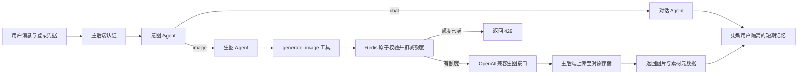

# 素材生图 Agent 服务

独立的 Python 3.13 / FastAPI / LangGraph 子项目，默认端口 `8958`，独立管理依赖和 `uv.lock`。
通过 HTTP 复用主后端的认证和对象存储接口，不导入 `backend/app`，不直接访问主业务数据库。

## 项目结构与维护边界

```text
agent-service/
├── agent_app/
│   ├── main.py                  # ASGI 入口，保持 agent_app.main:app
│   ├── bootstrap.py             # 创建依赖、启动清理任务、关闭资源
│   ├── core/
│   │   ├── config.py            # 环境配置与校验
│   │   └── errors.py            # 业务异常
│   ├── api/
│   │   ├── app.py               # FastAPI 工厂、CORS、生命周期
│   │   ├── auth.py              # 主后端登录校验
│   │   ├── dependencies.py      # 获取请求依赖
│   │   ├── exception_handlers.py
│   │   ├── router.py            # 聚合 /api/agent 路由
│   │   └── routes/              # chat、quota、assets、health
│   ├── schemas.py              # HTTP 与工具的数据契约
│   ├── agents/
│   │   ├── prompts.py           # 集中维护系统提示词
│   │   ├── intent.py            # 结构化意图识别
│   │   ├── chat.py              # 普通对话
│   │   └── image.py             # 生图规划与工具调用校验
│   ├── workflows/
│   │   ├── state.py             # checkpoint 状态与本轮运行上下文
│   │   └── builder.py           # LangGraph 节点、条件边及编译
│   ├── tools/
│   │   └── image_generation.py  # LangChain 工具注册、运行上下文注入
│   ├── services/
│   │   ├── conversation.py      # 会话隔离、历史裁剪、失败回滚
│   │   └── image_generation.py  # 扣额度、生成、保存与失败状态
│   ├── providers/
│   │   ├── chat.py              # OpenAI 兼容对话模型适配
│   │   ├── images.py            # OpenAI 兼容生图 HTTP 适配
│   │   └── assets.py            # 下载供应商图片、调用主后端存储
│   └── persistence/
│       ├── memory.py            # 进程内短期记忆、锁、TTL 与容量
│       └── quota.py             # Redis 每日原子额度
├── tests/                      # API、编排、存储、额度、记忆及生命周期回归
├── .env.example
├── pyproject.toml
├── uv.lock
├── Dockerfile
└── compose.yml
```

维护约定：

- 新增 Agent：在 `agents/` 编写节点及提示词，在 `workflows/builder.py` 注册节点和边。
- 新增工具：工具描述、参数和上下文注入放 `tools/`；业务规则放 `services/`；外部请求放 `providers/`。
- 更换模型供应商：修改或新增 provider，在 `bootstrap.py` 装配；避免让路由和 Agent 读取环境变量。
- 更换记忆或额度存储：从 `persistence/` 入手，保留会话锁、用户隔离和额度原子性。
- HTTP 路由只处理认证、请求、响应状态；异常统一在 `api/exception_handlers.py` 映射。
- 共享契约目前集中在较小的 `schemas.py`，规模扩大后按领域拆分；不为目录层级增加空的抽象层。
- 所有长生命周期依赖在 `bootstrap.py` 创建。自行创建的资源由容器关闭；测试注入的资源由调用者关闭。
- `AgentState` 会进入 checkpoint；Token、图片二进制和本轮结果只放 `RunContext`，不得写入 checkpoint。

## 业务流程



三个 Agent 使用各自提示词和权限，共用可配置的对话模型。讨论设计、写提示词、取消生成或
需求不明确时走普通对话；只有明确要求立即生图才调用工具。每轮最多调用一次，固定生成一张。

每用户每天最多 **5 次生图调用**，所有会话共享，默认北京时间次日 `00:00` 重置。
请求图片供应商之前原子扣减；供应商超时、报错或无效返回也计一次，不自动重试。
参数校验失败、没有有效工具调用、额度不足不扣减。清空对话不重置额度，Redis 不可用时拒绝调用。

生成的图片自动通过主后端上传至 `users/{user_id}/designs/generated/assets/`，返回素材元数据和临时 URL。
保存失败时返回已生成的图片，可以仅重试保存，不会再次生图或扣额度。
图片 URL 下载只允许生图 API 同主机或 `AGENT_IMAGE_DOWNLOAD_ALLOWED_HOSTS` 配置的 CDN 主机；
不跟随重定向、不把登录 Token 发送到图片供应商。Base64 返回不需要 CDN 配置。

## 本地启动

先启动主后端、PostgreSQL、Redis 和对象存储，确保认证与素材上传接口可用。

```powershell
cd agent-service
Copy-Item .env.example .env
# 填写模型地址、模型名、API Key、Redis 地址；URL 返回需配置图片 CDN 白名单。
uv sync --locked
uv run uvicorn agent_app.main:app --host 127.0.0.1 --port 8958 --workers 1
```

必填配置：`AGENT_CHAT_API_KEY`、`AGENT_CHAT_MODEL`、`AGENT_IMAGE_MODEL`、`AGENT_REDIS_URL`。
其他配置及默认值见 `.env.example`。对话模型需支持 Chat Completions function/tool calling，
图片模型需支持 `POST /images/generations`。`BASE_URL` 填 API 根路径（如 `/v1`），不含具体接口路径。
供应商特有的异步任务协议需要单独适配。

接口文档：<http://127.0.0.1:8958/docs>。`GET /api/agent/health` 仅表示 HTTP 进程可响应。

## 前端与素材管理

前端顶部“素材生成”进入创作对话和个人生成素材库；2D 编辑器顶部“素材生成”及上传图片面板的
“生成 / 选择云端素材”打开同一界面，可直接用于当前裁片。页面支持预览、下载、单张删除和批量删除。

Vite 默认将 `/api/agent` 代理到 `http://127.0.0.1:8958`，其他 `/api` 请求代理到 `8957`。
可通过 `VITE_AGENT_URL`、`VITE_BACKEND_URL` 修改代理目标。Key 只配置在服务端。

图库通过主后端 `GET /api/assets` 分页读取，批量删除使用 `POST /api/assets/batch-delete`，
这些接口不属于 Agent 服务。主后端负责对象存储凭据、用户路径隔离及删除结果；Agent 无需持有 S3 Key。
删除会永久移除图片，已引用该图片的设计可能受影响；界面在提交前展示确认。

## HTTP 接口

除健康检查外均要求主后端 `Authorization: Bearer <access_token>`，每次核验账号和会话状态。
客户端不能自行传入用户 ID。

| 方法 | 路径 | 用途 |
| --- | --- | --- |
| GET | `/api/agent/health` | 进程健康检查 |
| POST | `/api/agent/chat` | 对话或生图 |
| GET | `/api/agent/quota` | 本人当天调用额度 |
| DELETE | `/api/agent/conversations/{conversation_id}` | 清空本人会话 |
| POST | `/api/agent/assets/save` | 对返回的图片仅重试保存 |

首次请求：`{"message":"生成一张蓝白配色的老虎徽章"}`。后续带返回的 `conversation_id` 延续上下文。
响应字段为 `conversation_id`、`intent`、`status`、`reply`、`images`、`quota`。
普通聊天的 `images` 为空；生成成功后 `images[].asset` 包含 `asset_id`、`object_key`、文件名及临时 URL，
`images[].url` 指向对象存储。仅保存失败时保留供应商 URL 或完整 `data_url`，供保存重试。
重试请求体为对应的一项 `GeneratedImage`，成功返回含 `asset` 的图片。

| HTTP 状态 | 含义 |
| --- | --- |
| 200 | 成功 |
| 401 | 缺少凭据、会话失效或账号停用 |
| 422 | 请求不合法，包括空白消息、超长消息、非法 UUID、伪造 user_id |
| 429 | 额度已满，status 为 quota_exceeded，包含额度和 Retry-After |
| 502 | 模型或存储失败；生图业务失败的 status 为 generation_failed 或 storage_failed |
| 503 | 登录校验 / Redis 不可用或短期记忆容量已满 |

## 记忆与运行边界

- LangGraph `InMemorySaver` 按认证用户 ID 与会话 UUID 的哈希隔离，同一 UUID 在不同用户下也不会共享。
- 默认回放前 10 轮完整对话；空闲 1 小时过期，最多 1000 个会话，满时返回 503。
- 同一会话串行执行，每轮清理旧 checkpoint；失败清除未完成节点，保留之前完整对话。
- 记忆仅存在当前进程，重启即丢失。必须单 worker、单副本运行；扩容前需共享 checkpointer 和分布式会话锁。
- 额度在 Redis，重启恢复依赖 Redis 持久化；生产需启用 AOF 并保留数据卷。
- 当前为文字生图，“改颜色”结合旧描述生成新图，尚未实现精确图生图编辑。
- 意图准确率依赖所选模型，真实语义效果需配置供应商后评估。

## Docker

独立运行：在本目录填写 `.env` 后执行 `docker compose up --build -d`。
主后端在宿主机 `8957` 时，容器通过 `host.docker.internal` 访问认证和素材接口。

全栈运行：在 `deploy/` 执行 `docker compose --profile generation up --build -d`。
启用 Agent 与专用 Redis，Nginx 代理 `/api/agent/`。需要提前填写 `agent-service/.env`。
未启用 profile 时仍可运行原有前后端；Agent 环境文件可选加载，但启用服务后的必填配置仍会在启动时校验。

## 验证

```powershell
uv sync --locked
uv run pytest
uv run ruff check .
uv run ruff format --check .
```

测试覆盖真实 LangGraph / ToolNode、fakeredis Lua、真实 ChatOpenAI 协议适配及模拟 HTTP 上游，
无需真实 Key，不产生模型费用。重点回归认证、工具参数、并发额度、自然日切换、记忆隔离与清理、
存储失败恢复和资源生命周期。前端验证在 `frontend/` 执行 `npm test`、`npm run build`；
主后端验证在 `backend/` 执行 `uv run pytest`。
